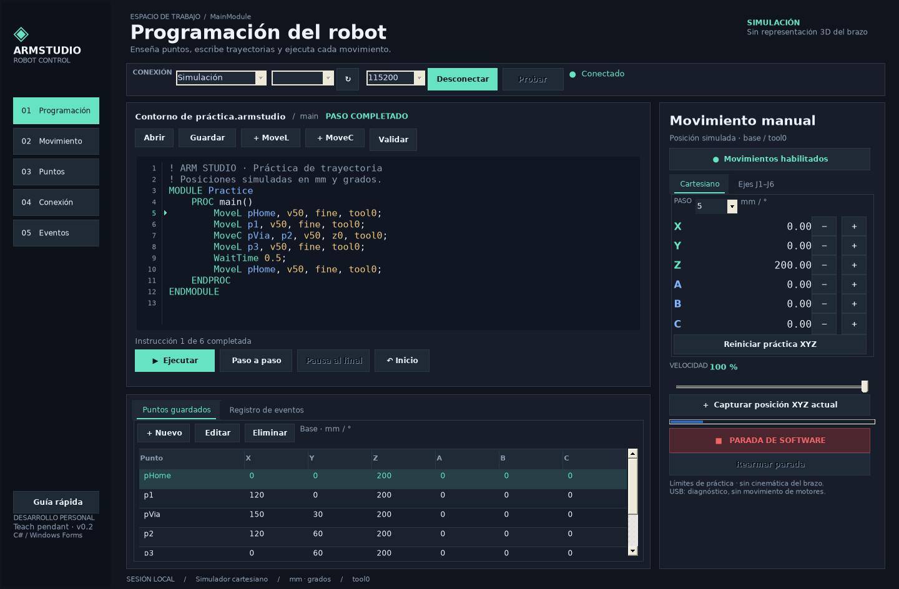
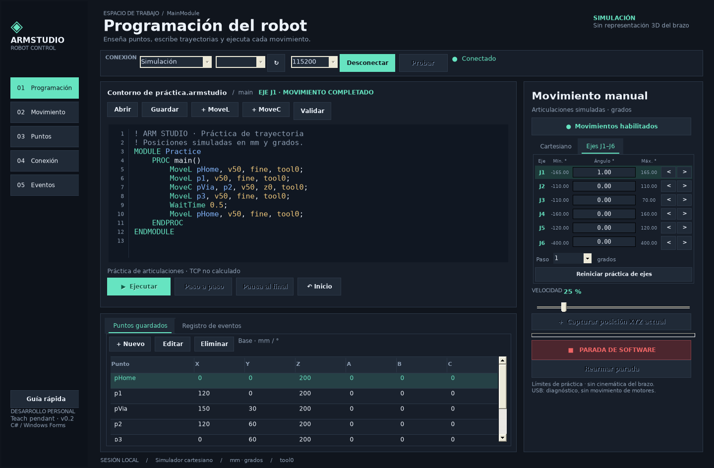

# ArmStudio 0.2

[](https://github.com/Raul-1993/ArmStudio/actions/workflows/build.yml)

Mando de control robótico de escritorio en **C# y Windows Forms**, pensado para practicar programación de trayectorias y evolucionar hacia un brazo impreso en 3D. Interfaz en español, sin representación 3D del robot.

## Descargar y probar en Windows

**[Descargar ArmStudio 0.2 para Windows](https://github.com/Raul-1993/ArmStudio/raw/refs/heads/main/downloads/ArmStudio-Windows.zip)**

1. Descarga el ZIP y extráelo completo.
2. Abre la carpeta `ArmStudio-Windows` y ejecuta `ArmStudio.exe`.
3. En la aplicación: **Simulación → Conectar → Habilitar movimientos**.
4. Para mover cada articulación: **Movimiento → Ejes J1–J6 → Iniciar práctica de ejes**.

Necesitas Windows 10/11 con .NET Framework 4.8. Para editar el código, descarga el repositorio mediante **Code → Download ZIP** y abre `ArmStudio.sln` en Visual Studio.



## Abrir y ejecutar

**Windows 10/11 con .NET Framework 4.8**. Para editar: Visual Studio 2022, carga de trabajo **Desarrollo de escritorio de .NET** y paquete de desarrollo de .NET Framework 4.8. No hay paquetes NuGet ni servicios de pago.

1. Abre `ArmStudio.sln`.
2. Establece **ArmStudio.WinForms** como proyecto de inicio.
3. Compila y pulsa **F5**.
4. Selecciona **Simulación**, pulsa **Conectar** y **Habilitar movimientos**.
5. Pulsa **Validar** y después **Paso a paso** o **Ejecutar**.

El ZIP de aplicación contiene una compilación portátil: extrae todos sus archivos en la misma carpeta y abre `ArmStudio.exe`. Conserva `ArmStudio.Core.dll` y `ArmStudio.exe.config` junto al ejecutable. Windows puede identificarla como una aplicación sin firma digital; esta primera versión no lleva instalador ni certificado de editor.

## Qué funciona

- Editor con colores, números de línea e indicador de instrucción activa.
- `MoveL`, `MoveC` y `WaitTime` con diagnósticos por línea.
- Tabla de puntos: creación, edición, eliminación y captura de la posición simulada.
- Movimiento incremental X/Y/Z y A/B/C; velocidad de programa entre 10 y 100 %.
- Apartado **Ejes J1–J6**, con ángulos articulares, límites, selección del eje, botones de ambos sentidos y paso configurable de 0,1° a 10°.
- Ejecución completa, paso a paso, pausa al terminar la instrucción actual y continuación.
- Parada de software, rearme explícito y habilitación independiente.
- Guardado de código y puntos en un único archivo JSON `.armstudio`.
- Registro de eventos exportable.
- Conexión USB/serie con selección de puerto, baudios, saludo de firmware, tiempo máximo y prueba `PING`/`STATUS`.
- Sketch Arduino de diagnóstico, separado del código de C#.

## Movimiento de cada eje como en RobotStudio

En el menú **Movimiento** o en la pestaña **Ejes J1–J6** del panel derecho encontrarás las seis articulaciones. Tras conectar el simulador y habilitar los movimientos, pulsa **Iniciar práctica de ejes**: todos los ángulos comienzan en cero. Elige el paso y usa `<` / `>` junto al eje que quieras mover. Los otros cinco ángulos se conservan. Una pulsación que alcanzaría el límite se queda exactamente en él; el sentido que sale del rango queda deshabilitado.

| Eje | Mínimo | Máximo |
| --- | --- | --- |
| J1 | −165° | 165° |
| J2 | −110° | 110° |
| J3 | −110° | 70° |
| J4 | −160° | 160° |
| J5 | −120° | 120° |
| J6 | −400° | 400° |

Estos valores reproducen el perfil de práctica de la captura, no los límites del futuro brazo. J1–J6 son las articulaciones; A/B/C son orientaciones cartesianas y no representan esos motores. La velocidad articular de referencia es 30°/s antes de aplicar el porcentaje del panel.

La práctica de ejes y la cartesiana son independientes porque todavía no hay una geometría definida para calcular cinemática. Al iniciar ejes, el TCP aparece como desconocido y quedan bloqueados el programa cartesiano y la captura de puntos XYZ. Para volver, selecciona **Cartesiano** y pulsa **Iniciar práctica XYZ**: la simulación empieza de nuevo en X=0, Y=0, Z=200, A=B=C=0, y los ángulos articulares dejan de mostrarse. Elegir otra pestaña por sí solo no cambia posiciones. Los botones de inicio de práctica solo reinician datos simulados; no son órdenes de homing físico.



## Una práctica

El ejemplo se carga al iniciar y también está en `examples/Contorno.armstudio`.

```text
MoveL pHome, v50, fine, tool0;
MoveL p1, v50, fine, tool0;
MoveC pVia, p2, v50, z0, tool0;
MoveL p3, v50, fine, tool0;
WaitTime 0.5;
MoveL pHome, v50, fine, tool0;
```

Los identificadores se resuelven en la tabla de puntos. `MoveC` pasa por el punto intermedio antes del destino. La velocidad `v50` representa 50 mm/s antes de aplicar el porcentaje del panel. Usa punto decimal en el código, por ejemplo `WaitTime 0.5;`.

`fine` y `z0` producen parada exacta; el simulador no incorpora blending. Solo existe `tool0`, sin compensación de herramienta. Se admite el envoltorio `MODULE` / `PROC main()`; el lenguaje es un **subconjunto didáctico inspirado en RAPID**, sin compatibilidad completa con ABB, bucles, variables ni sus controladores. El archivo `.mod` de ejemplo sirve para leer el código; la aplicación abre proyectos `.armstudio`, que incluyen sus puntos.

**XYZ:** milímetros, límites de práctica ±500. **ABC:** grados, límites ±180; se interpolan por componente, sin cuaterniones ni convención cinemática de un fabricante. No son ángulos de los motores. La simulación calcula posiciones cartesianas numéricas, no alcance mecánico, colisiones, cargas, aceleraciones ni cinemática inversa.

## Conectar una placa por USB

1. Abre `firmware/ArmStudioDiagnostic/ArmStudioDiagnostic.ino` en Arduino IDE.
2. Selecciona tu placa y puerto y carga el sketch.
3. Cierra el monitor serie para liberar el puerto.
4. En ArmStudio selecciona **USB / Serie**, actualiza los puertos con **↻**, elige el COM y **115200** baudios.
5. Pulsa **Conectar** y después **Probar USB**. El registro mostrará el saludo, `PONG` y `DIAGNOSTIC`.

El programa solo indica que está conectado tras recibir el saludo compatible. **El sketch incluido no genera señales para motores.** El modo serie mantiene deshabilitados los movimientos y no muestra una posición inventada. Otros firmwares, incluido GRBL, no son compatibles directamente. Documentación exacta: [protocolo serie](docs/serial-protocol.md).

## Teclas y comportamiento

| Acción | Tecla |
| --- | --- |
| Guardar proyecto | Ctrl+S |
| Guardar como | Ctrl+Shift+S |
| Abrir proyecto | Ctrl+O |
| Parada de software | Esc |

La pausa termina la instrucción actual. La parada cancela el movimiento y conserva la posición simulada; el puntero vuelve al inicio. Rearmar nunca habilita por sí solo los movimientos. Al cerrar se cancela la ejecución antes de preguntar por cambios sin guardar. Cada conexión al simulador empieza en X=0, Y=0, Z=200, A=B=C=0.

## Estructura para seguir aprendiendo

| Proyecto o carpeta | Responsabilidad |
| --- | --- |
| `ArmStudio.WinForms` | Formulario, editor, controles y coordinación de ejecución |
| `ArmStudio.Core` | Modelo, parser, geometría, archivos y transportes |
| `ArmStudio.Tests` | 53 comprobaciones funcionales sin dependencias de pruebas externas |
| `firmware` | Sketch de diagnóstico de la conexión USB |
| `examples` | Proyecto y texto de ejemplo |
| `tools` | Compilación, pruebas del formulario y comprobaciones del protocolo |

`IRobotTransport` separa el formulario de la simulación y de la comunicación serie. Esto permite incorporar después un controlador físico sin mezclar el protocolo con la presentación.

## Compilar y verificar

En una terminal de desarrollador de Visual Studio:

```powershell
msbuild ArmStudio.sln /m /p:Configuration=Release
.\ArmStudio.Tests\bin\Release\ArmStudio.Tests.exe
```

También puedes ejecutar `tools/build.ps1` desde PowerShell: compila, verifica y prepara `dist/ArmStudio`. La configuración de GitHub Actions incluida repite ese proceso en Windows cuando subas el código a tu repositorio.

La compilación con MSBuild y las 53 comprobaciones del núcleo (24 de articulaciones) pasaron en Windows mediante [GitHub Actions](https://github.com/Raul-1993/ArmStudio/actions/runs/42823960401). Además, en Linux con Mono pasaron 33 comprobaciones del formulario nativo, 5 escenarios serie con puerto emulado y 9 comprobaciones del protocolo del sketch. Las imágenes son capturas del formulario ejecutado; el aspecto de algunos controles nativos cambia en Windows. Quedan pendientes la revisión manual del formulario en un PC Windows y las pruebas con una placa Arduino física.

## Siguiente etapa: el brazo físico

Antes de controlar motores hay que decidir placa, número de ejes, servos o motores paso a paso, drivers, alimentación, longitudes y límites articulares. Después se implementarán calibración, referencias, cinemática inversa, planificación y confirmación real de movimiento. Ver [plan del brazo físico](docs/brazo-fisico.md).

La parada del formulario es una orden de software. El brazo físico necesitará una parada cableada y un control independiente que deje de accionar motores si se pierde la comunicación; la observación visual ayuda a verificar el movimiento, pero no sustituye esos controles.
